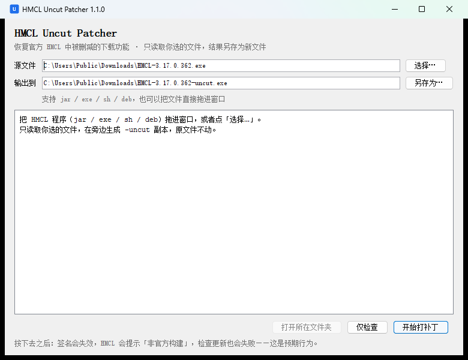

# HMCL-Uncut-Patcher

> 一个用于 **恢复官方 HMCL 构建中被删减功能** 的补丁工具。

它直接修改官方发布的 HMCL 程序文件，把「中国大陆地区禁用下载」这道门禁改成恒不生效。**不重新编译、不改源码、不修改你选中的原文件**，输出一份新文件。



<br/>

## 支持的文件

| 文件 | 平台 | 处理方式 |
|---|---|---|
| `HMCL-*.jar` | 通用 | 直接改写 jar 内的类 |
| `HMCL-*.exe` | Windows | 保留自解压引导程序，只替换尾部内嵌的 jar |
| `HMCL-*.sh` | Linux / macOS / FreeBSD | 同上，引导脚本原样保留 |
| `HMCL-*.deb` | Debian / Ubuntu | 展开 `data.tar.gz`，改写里面内嵌的自解压文件，再打包回去 |

补丁工具本身是纯 Java，**在 Windows、Linux、macOS 上都能跑**，只需要 Java 17 或更高。

<br/>

## 下载

到 [Releases](../../releases/latest) 下载 `HMCL-Uncut-Patcher.jar`（约 3.0 MB），需要 Java 17 或更高。

<br/>

## 用法

### 图形界面

```bash
java -jar HMCL-Uncut-Patcher.jar
```

不带参数启动就是窗口：选文件（或者直接把文件拖进窗口）→ 点「开始打补丁」。输出默认放在原文件旁边，文件名加 `-uncut`；成功后可以直接打开所在文件夹。

如果系统已经关联了 `.jar`，双击也能打开。想让窗口一打开就预选某个文件：

```bash
java -jar HMCL-Uncut-Patcher.jar --gui D:\下载\HMCL-3.17.0.362.exe
```

界面上还有「仅检查」，只验证文件能不能打补丁，不写出任何东西。

### 命令行

```bash
java -jar HMCL-Uncut-Patcher.jar HMCL-3.17.0.362.exe
```

同目录生成 `HMCL-3.17.0.362-uncut.exe`，原文件不动。

指定输出路径或只做检查：

```bash
java -jar HMCL-Uncut-Patcher.jar HMCL-3.17.0.362.jar -o D:\out\HMCL-uncut.jar
java -jar HMCL-Uncut-Patcher.jar HMCL-3.17.0.362.deb --check
```

**带参数就是命令行，不带参数（或 `--gui`）就是图形界面，两者是同一个 jar，行为完全一致。**

<br/>

## 补了什么

只改一个方法：`org.jackhuang.hmcl.util.RegionUtils#isIsChinaMainlandNetwork()Z`。

官方实现会先看机器是否在中国大陆（时区 / 系统地区 / Windows GeoID），再请求 `https://ipwho.is` 判断网络出口；只要判定成功，下载页就会被套上警告条并 `setDisable(true)`。

补丁把整个方法体替换成：

```java
public static boolean isIsChinaMainlandNetwork() {
    return false;
}
```

对应字节码 `iconst_0; ireturn`。两处调用点（`VersionsPage`、`DownloadListPage`）因此永远走 `else` 分支，下载页正常可用；同时 `init()` 里那次 IP 查询即使被调度也只会立刻返回，不会真的发请求。

**下载管线本身（`DownloadProvider`、`RemoteVersion`、`FileDownloader`、各下载源）完全没动。**

<br/>

## 安全性

- 打补丁前先做**门禁指纹校验**：方法必须存在、必须是 `static`、方法体必须引用私有字段 `isChinaMainlandNetwork` 或私有方法 `checkChinaMainlandNetwork`，否则拒绝
- 已经打过补丁的文件会被识别出来，不会重复套娃
- 打完之后重新读取整个文件，确认目标方法确实是 `iconst_0 / ireturn` 才写出
- 引导程序（exe 的 PE 头 / sh 的脚本）**逐字节保留**，只替换后面内嵌的 jar
- 不联网、不写注册表、不需要管理员权限
- 图形界面和命令行走的是同一套补丁代码，没有第二份实现

<br/>

## 已知影响

官方 jar 带有 `META-INF/hmcl_signature`，签名覆盖所有文件。改过任何一个类之后，签名必然失效，HMCL 会把当前程序判定为「非官方构建」：

- 界面上会出现「非官方构建」提示（仅提示，不影响登录与下载）
- **检查更新 / 自动更新会失败**（`SelfVerificationException`）。这其实是有意的：防止官方更新把打过补丁的文件悄悄覆盖掉
- 微软登录、CurseForge、整合包 / 模组下载等均正常

<br/>

## 自行构建

需要 JDK 17：

```bash
./gradlew fatJar
# 产物：build/dist/HMCL-Uncut-Patcher.jar
```

推送到 `main` 会触发 [`.github/workflows/build.yml`](.github/workflows/build.yml)，在 Ubuntu 上构建、跑启动模式检查与端到端自检，然后上传可执行 jar。

<br/>

## 声明

- 本工具是第三方工具，**不是 HMCL 官方产物**，与 HMCL 作者无关。
- 被修改的 HMCL 本体遵循 **GPLv3**；本工具同样以 GPLv3 分发。
- 原版移除相关功能是 HMCL 作者出于法规合规考虑所做的明确表态。本仓库不代表原作者立场，也不为其背书。
- 仅供个人学习与自用，**按「现状」提供，不提供任何明示或暗示的担保**。使用本仓库产生的任何后果由使用者自行承担。
- 如果你喜欢 HMCL，请支持原作者：[HMCL 官网](https://hmcl.huangyuhui.net/) · [GitHub](https://github.com/HMCL-dev/HMCL) · [爱发电](https://afdian.com/a/huanghongxun)
